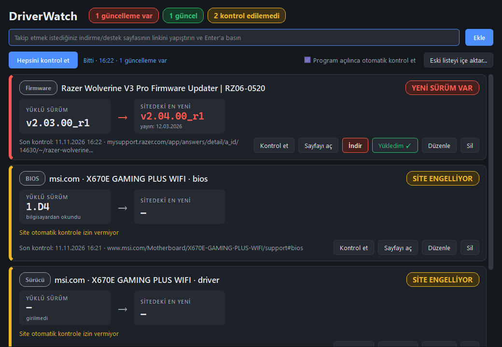

# DriverWatch

BIOS, sürücü ve firmware sayfalarını takip eden küçük bir Windows uygulaması. Üreticinin indirme/destek sayfasının linkini eklersiniz; program sayfadaki sürüm numaralarını bulur, siz takip edileni seçersiniz. Sonraki her kontrolde aynı yerdeki en yeni sürümü bulur ve bilgisayarınızda yüklü olanla karşılaştırır.

*English below.*



## Ne yapar

- **Link ekle, siz silene kadar kalsın.** Liste `%APPDATA%\DriverWatch\items.json` dosyasında saklanır.
- **Doğru sürümü seçersiniz.** Sayfada birden fazla sürüm varsa (ör. AMD sayfasında chipset ve RAID sürücüleri) hepsi bağlamıyla listelenir: `AMD Chipset Drivers › Revision Number › 8.09.28.1124 · 21.10.2026`. Seçtiğiniz sürüm, sayfadaki konumuna göre takip edilir; sürüm numarası değişince de aynı kalemi bulur.
- **Durum açıkça görünür.** Her kayıt bir kart: solda yüklü sürüm, sağda sitedeki en yeni sürüm ve yayın tarihi; üstte renkli durum etiketi:
  - 🔴 **YENİ SÜRÜM VAR**
  - 🟢 **GÜNCEL**
  - 🟡 **SİTE ENGELLİYOR / KONTROL EDİLEMEDİ / SÜRÜM BULUNAMADI**
  - 🔵 **YÜKLÜ SÜRÜM GİRİLMEDİ**
- **Sürüm numarası olmayan dosyaları tarihle takip eder.** Bazı sayfalarda (ör. ASUS monitör sürücüleri) yalnızca “Sürüm -” ve yayın tarihi yazar; bu kalemler yayın tarihine göre izlenir, daha yeni tarihli dosya çıkınca “YENİ SÜRÜM VAR” görünür.
- **Aynı sayfadan birden fazla dosya.** Ekleme penceresinde istediğiniz kadar kalemi işaretlersiniz; her biri ayrı kart olur.
- **Gizli indirme linklerini bulur.** “İndir” düğmesi gerçek bir link değilse, sayfanın içindeki veride duran dosya adresi aranır.
- **Yüklü sürümü Windows'tan okur.** Ekleme penceresindeki “Windows'tan oku” listesinden, Windows'un “Yüklü uygulamalar” listesindeki bir kayıt seçilir (ör. *AMD Chipset Software — 8.09.28.1124*); program uygun olanı kendisi önerir. Yüklü sürüm her kontrolde yeniden okunur, kurulum yapınca kart kendiliğinden “GÜNCEL”e döner. Aynı listede **Aygıt Yöneticisi** kayıtları da vardır (ör. *ROG STRIX XG27ACSR — 1.0.0.0, 17.03.2026*): sürüm numarası olmayan kalemlerde sürücü tarihi, diğerlerinde sürücü sürümü karşılaştırılır. Monitör ya da oyun kolu firmware'i Windows'ta görünmediği için bunlarda “Yükledim ✓” düğmesi kullanılır.
- **BIOS sürümünü bilgisayardan okur.** BIOS kayıtlarında yüklü sürüm Windows'tan alınır. MSI'nin sitedeki `7E16v1D4` ile Windows'un gösterdiği `1.D4` aynı sürüm sayılır.
- **"Yükledim ✓" düğmesi.** Yeni sürümü kurduktan sonra tek tıkla yüklü sürümü günceller.
- **İndirme linki.** Sayfada sürüme ait doğrudan link bulunursa “İndir” düğmesi çıkar.
- **Açılışta otomatik kontrol** (kapatılabilir).
- **Eski listeyi içe aktarma.** Önceki uygulamanın `tracker_data.json` dosyasındaki linkler eklenebilir.

## Sınırlar

- Bazı üreticiler (ör. MSI) görünmez Chrome'u (“HeadlessChrome”) reddediyor. **“Engelleyen sitelerde normal tarayıcı kimliği kullan”** seçeneği açıkken (varsayılan), program yalnızca bu sitelerde sayfayı bir kez daha, Chrome kendini normal masaüstü Chrome olarak tanıtarak açar; kartta “tarayıcı kimliğiyle okundu” yazar. Bu, sitenin kurallarına aykırı olabilir ve site korumasını değiştirirse çalışmayabilir; istemezseniz seçeneği kapatın. Kapalıyken ya da yine engellenirse kart **SİTE ENGELLİYOR** gösterir ve sürüm “Düzenle → En yeni (elle)” ile girilir.
- Beta sürümler listede kararlı sürümlerin altında gösterilir; kararlı sürümü takip eden kayıt betalarla karışmaz.
- JavaScript ile yüklenen sayfalar için Google Chrome kurulu olmalıdır (görünmez pencerede açılır).
- Sürücülerin yüklü sürümünü otomatik okumaz; ilk eklerken siz girersiniz ya da “Seçili sürüm yüklü” / “Yükledim ✓” düğmelerini kullanırsınız.

## Çalıştırma

```bash
python -m venv .venv
.venv\Scripts\python -m pip install -r requirements.txt
.venv\Scripts\python main.py
```

Tek dosyalık `.exe` üretmek için: `build.bat` (çıktı `dist\DriverWatch.exe`).

Testler: `.venv\Scripts\python -m unittest discover -s tests -t .`

---

## English

DriverWatch is a small Windows app (PyQt6) that watches vendor download/support pages for new BIOS, driver and firmware releases. Paste a page link, pick which of the versions found on the page you want to track, and it will show, on every check, the latest version at that spot next to the version installed on your PC, with a clear status badge (new version / up to date / site blocked). BIOS versions are read from Windows automatically. Some vendors (e.g. MSI) block automated access; those items are flagged and can be updated by hand. Requires Google Chrome for JavaScript-rendered pages.
